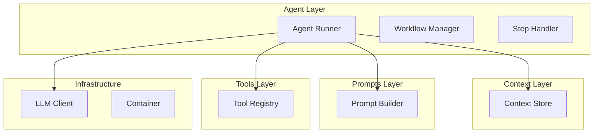

# Architecture

Tempo Sec follows an **"MVC for Agents"** pattern, separating concerns into four independent primitives that only the Agent composes together.

---

## Component Overview



| Component | Location | Responsibility |
|-----------|----------|----------------|
| **Context** | `tempo/context/` | State management, conversation history, branching |
| **Prompts** | `tempo/prompts/` | LLM instruction templates, phase configurations |
| **Tools** | `tempo/tools/` | Capability execution (shell, browser, files) |
| **Agent** | `tempo/agent/` | Orchestration, workflow control |
| **Infra** | `tempo/infra/` | Cross-cutting (LLM client, container, protocols) |
| **Visualization** | `tempo/visualization/` | Real-time UI server |

---

## Dependency Rules

> **CRITICAL**: Context, Prompts, and Tools MUST NOT import from each other.  
> They may only import from `infra/` or external packages.  
> Only Agent composes them together.

```
                    ┌─────────┐
                    │  Agent  │
                    └────┬────┘
                         │ depends on
          ┌──────────────┼──────────────┐
          ▼              ▼              ▼
     ┌─────────┐   ┌──────────┐   ┌─────────┐
     │ Context │   │  Prompts │   │  Tools  │
     └─────────┘   └──────────┘   └─────────┘
          │              │              │
          ▼              ▼              ▼
     ┌─────────────────────────────────────┐
     │              Infra                  │
     └─────────────────────────────────────┘
```

Use `tempo/infra/protocols.py` for cross-component type hints.

---

## Key Files

| File | Purpose |
|------|---------|
| `tempo/agent/runner.py` | Main agent loop |
| `tempo/agent/step_handler.py` | Tool execution logic |
| `tempo/agent/config.py` | Configuration (supports TOML) |
| `tempo/context/store.py` | Context tree management |
| `tempo/tools/registry.py` | Tool registration |
| `tempo/tools/tool_factory.py` | Tool instantiation |
| `tempo/infra/phases.py` | Phase enum definitions |
| `tempo/infra/protocols.py` | Cross-component interfaces |
| `tempo/visualization/server.py` | Real-time UI server |

---

## Project Structure

```
tempo/
├── agent/
│   ├── runner.py           # Main Agent class
│   ├── step_handler.py     # Tool execution
│   ├── workflow.py         # Phase state machine
│   ├── summarizer.py       # Output compression
│   ├── branch_coordinator.py # Parallel execution
│   ├── event_bus.py        # Event routing
│   └── config.py           # AgentConfig
│
├── context/
│   ├── store.py            # ContextStore
│   ├── frame.py            # ContextFrame, Message, ToolCall
│   └── persistence.py      # JSON serialization
│
├── prompts/
│   ├── builder.py          # PromptBuilder
│   ├── phases.py           # Phase configurations
│   └── templates/          # Markdown templates
│
├── tools/
│   ├── base.py             # Tool ABC, ToolResult
│   ├── registry.py         # ToolRegistry
│   ├── tool_factory.py     # Tool instantiation
│   ├── shell.py            # ShellTool
│   ├── browser_tools.py    # Playwright-style browser tools
│   ├── filesystem.py       # File read/write
│   ├── meta.py             # Phase transitions, summarization
│   ├── testplan_tools.py   # Test plan management
│   ├── manifest_tools.py   # Target manifest handling
│   └── view_output.py      # Output viewing
│
├── visualization/
│   ├── server.py           # WebSocket server
│   ├── collector.py        # Event collection
│   └── ui/                 # HTML/CSS/JS frontend
│
├── infra/
│   ├── llm.py              # LLMClient, LiteLLMClient
│   ├── container.py        # ContainerManager
│   ├── phases.py           # Phase enum
│   └── protocols.py        # Type interfaces
│
└── scripts/
    ├── recon.py            # Reconnaissance script
    └── test_cycle.py       # Testing cycle script
```

---

## Design Goals

1. **Maximize Cohesion**: Each component has a single, clear responsibility
2. **Minimize Coupling**: Components have zero dependencies on each other; only Agent composes them
3. **Enable Testing**: Each component can be unit tested in isolation
4. **Support Extension**: New tools, prompts, or context backends can be added without modifying other components

---

## See Also

- [WORKFLOW.md](WORKFLOW.md) - Phase workflow and branching
- [TOOLS.md](TOOLS.md) - Tool specifications
- [diagrams/](../diagrams/README.md) - Visual architecture diagrams
