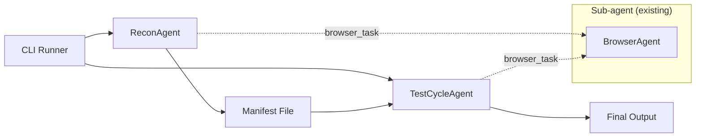
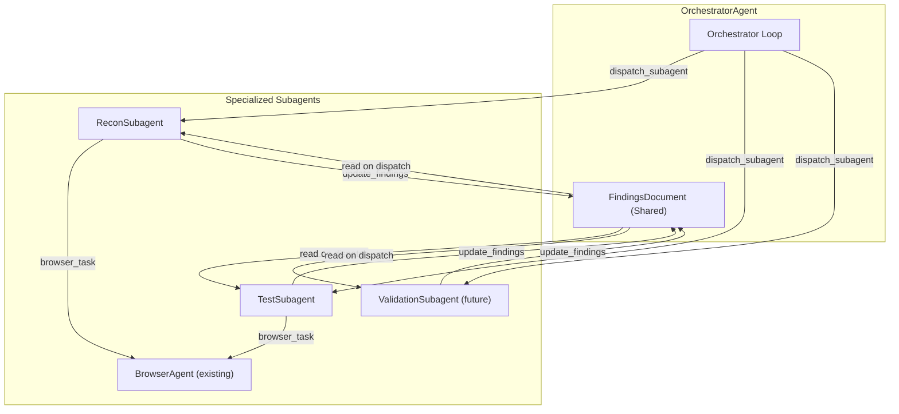

# Orchestrator Architecture Specification

This document specifies the architecture for transitioning Tempo Sec to an orchestrator-based multi-agent system with shared findings.

---

## Executive Summary

The current system uses independent agents (ReconAgent, TestCycleAgent) that run sequentially via CLI. This specification proposes an **OrchestratorAgent** that dynamically dispatches specialized subagents based on analysis needs, with all agents contributing to a **shared FindingsDocument**.

### Key Benefits

| Benefit | Description |
|---------|-------------|
| **Autonomous Analysis** | Orchestrator decides when to recon, test, or reflect |
| **Parallel Testing** | Multiple attack surfaces can be tested concurrently |
| **Shared Knowledge** | Findings persist across all subagent invocations |
| **Modularity** | Easy to add new specialized subagents |
| **Efficiency** | Avoid redundant work through shared state |

---

## Current Architecture



**Current Limitations:**
1. Sequential execution only (recon → test)
2. No dynamic decision-making about what to investigate
3. Findings not shared between runs (only manifest transfer)
4. Manual intervention required to restart or redirect analysis

---

## Proposed Architecture



### Core Concepts

| Concept | Description |
|---------|-------------|
| **OrchestratorAgent** | Top-level agent that plans, dispatches, and synthesizes |
| **Subagent** | Specialized agent for a specific task (recon, test, validate) |
| **FindingsDocument** | Persistent, structured document updated by all agents |
| **Dispatch Tool** | Tool for orchestrator to invoke subagents |
| **Completion Tool** | Tool for subagents to report back to orchestrator |

---

## Detailed Component Specifications

### 1. FindingsDocument

A structured, persistent document that accumulates knowledge across all agent interactions.

#### Location

```
/Users/nathanwang/Projects/tempo-sec-2/tempo/findings/
├── __init__.py
├── document.py        # FindingsDocument class
├── schema.py          # Pydantic models for findings
└── persistence.py     # JSON/YAML serialization
```

#### Schema Design

```python
# tempo/findings/schema.py

from pydantic import BaseModel
from datetime import datetime
from enum import Enum

class Severity(str, Enum):
    CRITICAL = "critical"
    HIGH = "high"
    MEDIUM = "medium"
    LOW = "low"
    INFO = "info"

class FindingStatus(str, Enum):
    SUSPECTED = "suspected"      # Hypothesis, not yet tested
    CONFIRMED = "confirmed"      # Validated vulnerability
    FALSE_POSITIVE = "false_positive"
    NEEDS_MANUAL = "needs_manual_verification"

class AttackSurface(BaseModel):
    """A potential attack surface identified during recon."""
    id: str
    surface_type: str           # endpoint, form, api, websocket, etc.
    url: str
    description: str
    parameters: list[str] = []
    technology_hints: list[str] = []
    tested: bool = False
    priority: str = "medium"
    discovered_at: datetime
    discovered_by: str          # Agent that found it

class Finding(BaseModel):
    """A security finding (vulnerability or observation)."""
    id: str
    title: str
    severity: Severity
    status: FindingStatus
    attack_surface_id: str | None = None
    description: str
    evidence: str
    reproduction_steps: list[str] = []
    remediation: str = ""
    discovered_at: datetime
    discovered_by: str          # Agent that found it
    validated_by: str | None = None
    
class ReconSummary(BaseModel):
    """Summary of reconnaissance results."""
    target_domain: str
    technologies: list[str] = []
    endpoints_discovered: int = 0
    forms_discovered: int = 0
    apis_discovered: int = 0
    notes: list[str] = []

class FindingsDocumentSchema(BaseModel):
    """Root schema for the findings document."""
    version: str = "1.0"
    target: str
    created_at: datetime
    updated_at: datetime
    
    # Accumulated data
    recon_summary: ReconSummary | None = None
    attack_surfaces: list[AttackSurface] = []
    findings: list[Finding] = []
    
    # Tracking
    agents_invoked: list[str] = []
    total_steps_taken: int = 0
```

#### FindingsDocument Class

```python
# tempo/findings/document.py

from pathlib import Path
from datetime import datetime
from tempo.findings.schema import (
    FindingsDocumentSchema,
    AttackSurface,
    Finding,
    ReconSummary,
)

class FindingsDocument:
    """
    Thread-safe, persistent findings document.
    
    Used by all agents to read/write shared findings.
    Follows the project's dependency rules - lives in its own module,
    no imports from tools/prompts/context.
    """
    
    def __init__(self, target: str, path: Path | None = None):
        self._path = path or Path(f"./findings/{target.replace('.', '_')}.json")
        self._data = FindingsDocumentSchema(
            target=target,
            created_at=datetime.utcnow(),
            updated_at=datetime.utcnow(),
        )
    
    @classmethod
    def load(cls, path: Path) -> "FindingsDocument":
        """Load from existing file."""
        ...
    
    def save(self) -> None:
        """Persist to disk."""
        self._data.updated_at = datetime.utcnow()
        self._path.parent.mkdir(parents=True, exist_ok=True)
        self._path.write_text(self._data.model_dump_json(indent=2))
    
    # === Query Methods ===
    
    def get_untested_surfaces(self, limit: int = 5) -> list[AttackSurface]:
        """Get attack surfaces that haven't been tested yet."""
        ...
    
    def get_findings_by_severity(self, severity: str) -> list[Finding]:
        """Get findings filtered by severity."""
        ...
    
    def get_summary(self) -> str:
        """Get a text summary for agent context."""
        ...
    
    # === Update Methods ===
    
    def add_attack_surface(self, surface: AttackSurface) -> None:
        """Add a new attack surface."""
        ...
    
    def add_finding(self, finding: Finding) -> None:
        """Add a new finding."""
        ...
    
    def mark_surface_tested(self, surface_id: str, tested_by: str) -> None:
        """Mark an attack surface as tested."""
        ...
    
    def update_recon_summary(self, summary: ReconSummary) -> None:
        """Update recon summary."""
        ...
```

---

### 2. OrchestratorAgent

The top-level agent that coordinates all analysis.

#### Location

```
tempo/agents/orchestrator.py
```

#### Design

```python
# tempo/agents/orchestrator.py

@register_agent
class OrchestratorAgent(BaseAgentDefinition):
    """
    Orchestrator agent that coordinates security analysis.
    
    Responsibilities:
    - Decides what analysis is needed next
    - Dispatches specialized subagents
    - Synthesizes findings into final report
    - Determines when analysis is complete
    """
    
    _name = "orchestrator"
    _model = "anthropic/claude-sonnet-4-20250514"  # Smarter model for planning
    _initial_phase = Phase.RECON  # Starts in recon
    
    def __init__(
        self,
        target: str,
        findings_path: str | None = None,
        max_iterations: int = 10,
        **kwargs,
    ):
        self.target = target
        self._findings_path = findings_path
        self._max_iterations = max_iterations
        self._findings: FindingsDocument | None = None
    
    @property
    def findings(self) -> FindingsDocument:
        """Lazy-load or create findings document."""
        if self._findings is None:
            if self._findings_path and Path(self._findings_path).exists():
                self._findings = FindingsDocument.load(Path(self._findings_path))
            else:
                self._findings = FindingsDocument(target=self.target)
        return self._findings
    
    def create_tools(self, context, container=None, workflow=None, **kwargs):
        tools = ToolRegistry()
        
        # Analysis tools - orchestrator can also do lightweight analysis
        tools.register(ShellTool(container_manager=container))
        tools.register(FileReadTool(container_manager=container))
        tools.register(FileWriteTool(container_manager=container))
        
        # Subagent dispatch tools (THE KEY ADDITION)
        tools.register(DispatchSubagentTool(
            findings=self.findings,
            container_manager=container,
        ))
        
        # Findings management
        tools.register(ReadFindingsTool(findings=self.findings))
        tools.register(AddFindingTool(findings=self.findings))
        tools.register(AddAttackSurfaceTool(findings=self.findings))
        
        # Meta tools
        tools.register(SummarizeOutputTool(context_store=context))
        tools.register(FinalizeAnalysisTool(findings=self.findings))
        
        return tools
    
    def build_objective(self, target: str | None = None, **kwargs) -> str:
        target = target or self.target
        findings_summary = self.findings.get_summary()
        
        return f"""## Security Analysis Orchestration

**Target:** {target}

### Your Role
You are the orchestrator for a comprehensive security analysis. Your job is to:
1. **Assess** the current state of knowledge (see findings below)
2. **Decide** what analysis is needed next
3. **Dispatch** specialized subagents to perform specific tasks
4. **Synthesize** results into actionable findings
5. **Determine** when the analysis is sufficiently complete

### Current Findings
{findings_summary if findings_summary else "No findings yet. Start with reconnaissance."}

### Available Subagents
- `recon`: Deep reconnaissance - crawling, technology fingerprinting, attack surface mapping
- `test`: Targeted security testing - test specific attack surfaces with specific hypotheses
- (future) `validate`: Validate and PoC confirmed findings

### Decision Framework
1. If little is known about the target → dispatch recon subagent
2. If attack surfaces exist but are untested → dispatch test subagent(s)
3. If critical findings need validation → dispatch validation subagent
4. If coverage is sufficient → finalize analysis

### Output
When analysis is complete, call `finalize_analysis` with a comprehensive report.
"""
```

---

### 3. Subagent Dispatch Mechanism

The key architectural piece - how the orchestrator invokes subagents.

#### Location

```
tempo/tools/dispatch_subagent.py
```

#### Design

```python
# tempo/tools/dispatch_subagent.py

class DispatchSubagentTool(Tool):
    """
    Dispatch a specialized subagent to perform a focused task.
    
    This is the orchestrator's primary mechanism for delegating work.
    Each subagent runs independently but shares the FindingsDocument.
    """
    
    name = "dispatch_subagent"
    description = """Dispatch a specialized subagent to perform a focused task.

Available subagents:
- recon: Performs deep reconnaissance on a target or specific area
- test: Tests specific attack surfaces for vulnerabilities

The subagent will:
1. Receive the current findings as context
2. Execute its specialized workflow
3. Update the findings document with any discoveries
4. Return a summary of what was accomplished

Use this when you need focused, specialized analysis that benefits from
a dedicated agent workflow."""
    
    category = ToolCategory.META
    
    def __init__(
        self,
        findings: FindingsDocument,
        container_manager: "ContainerManager | None" = None,
    ):
        self._findings = findings
        self._container = container_manager
    
    async def execute(
        self,
        subagent_type: str,
        objective: str,
        focus_area: str = "",
        max_steps: int = 50,
        **kwargs,
    ) -> ToolResult:
        """
        Execute a subagent.
        
        Args:
            subagent_type: Type of subagent (recon, test)
            objective: What the subagent should accomplish
            focus_area: Optional focus area (URL, attack surface ID, etc.)
            max_steps: Maximum steps for subagent
        """
        # Get subagent class
        subagent_class = self._get_subagent_class(subagent_type)
        if not subagent_class:
            return ToolResult(
                success=False,
                error=f"Unknown subagent type: {subagent_type}",
            )
        
        # Create subagent with findings reference
        subagent = subagent_class(
            objective=objective,
            focus_area=focus_area,
            findings=self._findings,
        )
        
        # Create isolated context
        subagent_context = ContextStore()
        
        # Create tools
        tools = subagent.create_tools(
            context=subagent_context,
            container=self._container,
        )
        
        # Create and run agent
        from tempo.infra.llm import LiteLLMClient
        llm = LiteLLMClient(model=subagent.model)
        
        config = AgentConfig(
            model=subagent.model,
            max_total_steps=max_steps,
        )
        
        prompts = PromptBuilder()
        system_prompt = subagent.build_system_prompt(
            prompts=prompts,
            tool_schemas=tools.get_schemas(),
            scope_description=f"Security analysis of {self._findings._data.target}",
        )
        
        from tempo.context.frame import MessageRole
        subagent_context.add_message(MessageRole.SYSTEM, system_prompt)
        
        agent = Agent(
            config=config,
            llm=llm,
            tools=tools,
            context=subagent_context,
        )
        
        # Build objective with findings context
        full_objective = subagent.build_objective()
        
        try:
            result = await agent.run(
                objective=full_objective,
                max_steps=max_steps,
            )
            
            # Save findings (subagent may have updated them)
            self._findings.save()
            
            return ToolResult(
                success=result.success,
                output=self._format_subagent_result(subagent_type, result),
                metadata={
                    "subagent_type": subagent_type,
                    "steps_taken": result.steps_taken,
                    "findings_count": len(result.findings),
                },
            )
            
        except Exception as e:
            return ToolResult(
                success=False,
                output=f"Subagent execution failed: {str(e)}",
                error=str(e),
            )
    
    def _get_subagent_class(self, subagent_type: str):
        """Get the subagent class by type."""
        from tempo.agents import get_agent
        
        mapping = {
            "recon": "recon_subagent",
            "test": "test_subagent",
        }
        
        agent_name = mapping.get(subagent_type)
        if agent_name:
            return get_agent(agent_name)
        return None
    
    def _format_subagent_result(self, subagent_type: str, result) -> str:
        """Format subagent result for orchestrator."""
        parts = [
            f"## {subagent_type.title()} Subagent Completed",
            f"**Steps taken:** {result.steps_taken}",
            f"**Success:** {result.success}",
        ]
        
        if result.findings:
            parts.append(f"**New findings:** {len(result.findings)}")
            for f in result.findings[:5]:  # Show first 5
                parts.append(f"- {f.get('title', 'Untitled')}")
        
        if result.error:
            parts.append(f"**Error:** {result.error}")
        
        return "\n".join(parts)
    
    def get_schema(self) -> ToolSchema:
        return ToolSchema(
            name=self.name,
            description=self.description,
            parameters={
                "type": "object",
                "properties": {
                    "subagent_type": {
                        "type": "string",
                        "enum": ["recon", "test"],
                        "description": "Type of subagent to dispatch",
                    },
                    "objective": {
                        "type": "string",
                        "description": "What the subagent should accomplish",
                    },
                    "focus_area": {
                        "type": "string",
                        "description": "Optional: specific area to focus on (URL, attack surface ID)",
                    },
                    "max_steps": {
                        "type": "integer",
                        "description": "Maximum steps for subagent (default: 50)",
                        "default": 50,
                    },
                },
                "required": ["subagent_type", "objective"],
            },
        )
```

---

### 4. Specialized Subagents

Refactored versions of existing agents designed to work with the orchestrator.

#### ReconSubagent

```python
# tempo/agents/recon_subagent.py

@register_agent
class ReconSubagent(BaseAgentDefinition):
    """
    Reconnaissance subagent for deep target analysis.
    
    Unlike the standalone ReconAgent, this:
    - Receives findings as input context
    - Updates the shared FindingsDocument
    - Reports back to orchestrator
    """
    
    _name = "recon_subagent"
    _model = "openai/gpt-4o-mini"
    _initial_phase = Phase.RECON
    
    def __init__(
        self,
        objective: str,
        findings: FindingsDocument,
        focus_area: str = "",
        **kwargs,
    ):
        self.objective = objective
        self.focus_area = focus_area
        self._findings = findings
    
    def create_tools(self, context, container=None, workflow=None, **kwargs):
        tools = ToolRegistry()
        
        # Core tools
        tools.register(ShellTool(container_manager=container))
        tools.register(FileReadTool(container_manager=container))
        tools.register(FileWriteTool(container_manager=container))
        tools.register(BrowserTaskTool(container_manager=container))
        
        # Findings tools (write to shared document)
        tools.register(AddAttackSurfaceTool(findings=self._findings))
        tools.register(UpdateReconSummaryTool(findings=self._findings))
        
        # Meta
        tools.register(SummarizeOutputTool(context_store=context))
        tools.register(CompleteSubtaskTool())  # Signal completion
        
        return tools
    
    def build_objective(self, **kwargs) -> str:
        findings_summary = self._findings.get_summary()
        
        return f"""## Reconnaissance Task

**Objective:** {self.objective}

{"**Focus Area:** " + self.focus_area if self.focus_area else ""}

### Current Knowledge
{findings_summary if findings_summary else "No prior findings."}

### Your Task
Perform focused reconnaissance:
1. Crawl and map the target
2. Identify technologies and frameworks
3. Discover attack surfaces (endpoints, forms, APIs)
4. Add each discovered attack surface using `add_attack_surface`
5. When complete, call `complete_subtask` with a summary

### Important
- Focus on DISCOVERY, not exploitation
- Add ALL attack surfaces you find to the findings document
- Be thorough but efficient
"""
```

#### TestSubagent

```python
# tempo/agents/test_subagent.py

@register_agent
class TestSubagent(BaseAgentDefinition):
    """
    Testing subagent for vulnerability validation.
    
    Focused on testing specific attack surfaces with specific hypotheses.
    Updates findings with confirmed vulnerabilities.
    """
    
    _name = "test_subagent"
    _model = "openai/gpt-4o-mini"
    _initial_phase = Phase.TEST
    
    def __init__(
        self,
        objective: str,
        findings: FindingsDocument,
        focus_area: str = "",
        **kwargs,
    ):
        self.objective = objective
        self.focus_area = focus_area
        self._findings = findings
    
    def create_tools(self, context, container=None, workflow=None, **kwargs):
        tools = ToolRegistry()
        
        # Core tools
        tools.register(ShellTool(container_manager=container))
        tools.register(FileReadTool(container_manager=container))
        tools.register(FileWriteTool(container_manager=container))
        tools.register(BrowserTaskTool(container_manager=container))
        
        # Findings tools
        tools.register(AddFindingTool(findings=self._findings))
        tools.register(MarkSurfaceTestedTool(findings=self._findings))
        
        # Meta
        tools.register(SummarizeOutputTool(context_store=context))
        tools.register(CompleteSubtaskTool())
        
        return tools
    
    def build_objective(self, **kwargs) -> str:
        # Get relevant attack surfaces
        if self.focus_area:
            surfaces = [s for s in self._findings._data.attack_surfaces 
                       if s.id == self.focus_area or self.focus_area in s.url]
        else:
            surfaces = self._findings.get_untested_surfaces(limit=5)
        
        surfaces_text = "\n".join([
            f"- [{s.priority}] {s.surface_type}: {s.url}"
            for s in surfaces
        ]) if surfaces else "No specific attack surfaces assigned."
        
        return f"""## Security Testing Task

**Objective:** {self.objective}

### Attack Surfaces to Test
{surfaces_text}

### Your Task
1. Form specific, testable hypotheses for each attack surface
2. Execute tests to validate/disprove hypotheses
3. For confirmed vulnerabilities:
   - Add finding using `add_finding` with evidence
   - Mark the surface as tested
4. For negative results:
   - Still mark the surface as tested
5. Call `complete_subtask` when done

### Testing Guidelines
- Always test in a non-destructive manner
- Collect clear evidence for any findings
- Include reproduction steps
"""
```

---

### 5. Findings Tools

Tools for interacting with the shared findings document.

#### Location

```
tempo/tools/findings_tools.py
```

#### Design

```python
# tempo/tools/findings_tools.py

class ReadFindingsTool(Tool):
    """Read current findings summary."""
    name = "read_findings"
    description = "Get the current state of all findings and attack surfaces."
    
    def __init__(self, findings: FindingsDocument):
        self._findings = findings
    
    async def execute(self, **kwargs) -> ToolResult:
        return ToolResult(
            success=True,
            output=self._findings.get_summary(),
        )


class AddAttackSurfaceTool(Tool):
    """Add a discovered attack surface."""
    name = "add_attack_surface"
    description = "Add a newly discovered attack surface to the findings."
    
    async def execute(
        self,
        surface_type: str,
        url: str,
        description: str,
        parameters: list[str] = None,
        priority: str = "medium",
        **kwargs,
    ) -> ToolResult:
        surface = AttackSurface(
            id=str(uuid.uuid4()),
            surface_type=surface_type,
            url=url,
            description=description,
            parameters=parameters or [],
            priority=priority,
            discovered_at=datetime.utcnow(),
            discovered_by=kwargs.get("agent_name", "unknown"),
        )
        self._findings.add_attack_surface(surface)
        self._findings.save()
        
        return ToolResult(
            success=True,
            output=f"Added attack surface: {surface_type} at {url}",
            metadata={"surface_id": surface.id},
        )


class AddFindingTool(Tool):
    """Add a security finding."""
    name = "add_finding"
    description = "Record a confirmed or suspected security finding."
    
    async def execute(
        self,
        title: str,
        severity: str,
        status: str,
        description: str,
        evidence: str,
        attack_surface_id: str = None,
        reproduction_steps: list[str] = None,
        **kwargs,
    ) -> ToolResult:
        finding = Finding(
            id=str(uuid.uuid4()),
            title=title,
            severity=Severity(severity),
            status=FindingStatus(status),
            attack_surface_id=attack_surface_id,
            description=description,
            evidence=evidence,
            reproduction_steps=reproduction_steps or [],
            discovered_at=datetime.utcnow(),
            discovered_by=kwargs.get("agent_name", "unknown"),
        )
        self._findings.add_finding(finding)
        self._findings.save()
        
        return ToolResult(
            success=True,
            output=f"Added {severity} finding: {title}",
            metadata={"finding_id": finding.id},
        )


class MarkSurfaceTestedTool(Tool):
    """Mark an attack surface as tested."""
    name = "mark_surface_tested"
    
    async def execute(self, surface_id: str, **kwargs) -> ToolResult:
        self._findings.mark_surface_tested(
            surface_id, 
            tested_by=kwargs.get("agent_name", "unknown"),
        )
        self._findings.save()
        return ToolResult(success=True, output=f"Marked {surface_id} as tested")
```

---

### 6. Subagent Completion Mechanism

#### Location

```
tempo/tools/complete_subtask.py
```

#### Design

```python
# tempo/tools/complete_subtask.py

class CompleteSubtaskTool(Tool):
    """
    Signal that a subagent has completed its task.
    
    Similar to the existing CompleteBrowserTaskTool, but for
    orchestrated subagents.
    """
    
    name = "complete_subtask"
    description = """Signal that you have completed your assigned subtask.

Call this when you have:
1. Completed the assigned objective
2. Added all relevant findings/surfaces to the shared document
3. Are ready to return control to the orchestrator

Provide a summary of what was accomplished and any important observations."""
    
    category = ToolCategory.META
    
    async def execute(
        self,
        summary: str,
        surfaces_added: int = 0,
        findings_added: int = 0,
        notes: str = "",
        **kwargs,
    ) -> ToolResult:
        """
        Complete the subtask.
        
        The runner will detect this special tool and terminate the subagent.
        """
        return ToolResult(
            success=True,
            output=f"Subtask completed: {summary}",
            metadata={
                "subtask_complete": True,  # Signal to runner
                "summary": summary,
                "surfaces_added": surfaces_added,
                "findings_added": findings_added,
                "notes": notes,
            },
        )
```

---

## File Structure

Complete proposed file structure:

```
tempo/
├── agents/
│   ├── __init__.py           # Agent registry (update)
│   ├── base.py               # BaseAgentDefinition (no changes)
│   ├── browser.py            # BrowserAgent (no changes)
│   ├── recon.py              # ReconAgent (keep for standalone use)
│   ├── test_cycle.py         # TestCycleAgent (keep for standalone use)
│   ├── orchestrator.py       # NEW: OrchestratorAgent
│   ├── recon_subagent.py     # NEW: ReconSubagent
│   └── test_subagent.py      # NEW: TestSubagent
│
├── findings/                  # NEW module
│   ├── __init__.py
│   ├── schema.py             # Pydantic models
│   ├── document.py           # FindingsDocument class
│   └── persistence.py        # JSON serialization
│
├── tools/
│   ├── ...                   # Existing tools
│   ├── dispatch_subagent.py  # NEW: Dispatch tool
│   ├── findings_tools.py     # NEW: Findings manipulation tools
│   └── complete_subtask.py   # NEW: Subtask completion tool
│
├── prompts/
│   └── templates/
│       ├── ...               # Existing templates
│       └── orchestrator.txt  # NEW: Orchestrator system prompt
│
└── scripts/
    └── run.py                # Update to support orchestrator
```

---

## Dependency Rules Compliance

This design strictly follows the project's dependency rules:

```
                    ┌──────────────┐
                    │ OrchestratorAgent │
                    └───────┬──────┘
                            │ depends on
         ┌──────────────────┼──────────────────┐
         ▼                  ▼                  ▼
    ┌─────────┐       ┌──────────┐       ┌─────────┐
    │ Context │       │  Prompts │       │  Tools  │
    └─────────┘       └──────────┘       └─────────┘
         │                  │                  │
         ▼                  ▼                  ▼
    ┌─────────────────────────────────────────────┐
    │                   Infra                      │
    │  (includes FindingsDocument as new module)   │
    └─────────────────────────────────────────────┘
```

**Key Points:**
- `FindingsDocument` lives in `findings/` (sibling to `infra/`)
- Tools can import from `findings/` (same level as `infra/`)
- Agents compose everything together
- No circular dependencies

---

## Protocol Additions

New protocols for `tempo/infra/protocols.py`:

```python
# New additions to protocols.py

class SubagentDispatcher(Protocol):
    """Protocol for components that can dispatch subagents."""
    
    async def dispatch(
        self,
        subagent_type: str,
        objective: str,
        **kwargs,
    ) -> Any:
        """Dispatch a subagent with the given objective."""
        ...


class FindingsUpdater(Protocol):
    """Protocol for components that can update findings."""
    
    def add_finding(self, finding: dict) -> str:
        """Add a finding, return its ID."""
        ...
    
    def add_attack_surface(self, surface: dict) -> str:
        """Add an attack surface, return its ID."""
        ...
    
    def get_summary(self) -> str:
        """Get current findings summary."""
        ...
```

---

## Configuration

Add orchestrator configuration to `config.toml`:

```toml
[orchestrator]
# Maximum iterations for orchestrator loop
max_iterations = 10

# Default max steps per subagent dispatch
default_subagent_steps = 50

# Model for orchestrator (uses smarter model)
model = "anthropic/claude-sonnet-4-20250514"

# Model for subagents (faster model)
subagent_model = "openai/gpt-4o-mini"

[orchestrator.auto_dispatch]
# Automatically dispatch recon if no attack surfaces
auto_recon = true

# Maximum concurrent subagents (future)
max_concurrent = 3
```

---

## CLI Interface

Update `tempo/scripts/run.py`:

```bash
# Run orchestrator (new recommended workflow)
tempo orchestrator \
    --target https://example.com \
    --findings ./findings/example.json \
    --max-iterations 10

# Still support standalone agents
tempo recon --target https://example.com
tempo test_cycle --manifest ./manifests/example.json
```

---

## Migration Path

### Phase 1: Foundations (Non-Breaking)
1. Create `tempo/findings/` module with schema and document
2. Add findings tools to `tempo/tools/`
3. Add protocols to `protocols.py`
4. Write tests for findings module

### Phase 2: Subagents (Non-Breaking)
1. Create `ReconSubagent` and `TestSubagent`
2. Create `DispatchSubagentTool` and `CompleteSubtaskTool`
3. Add subagent prompts
4. Write integration tests

### Phase 3: Orchestrator (New Feature)
1. Create `OrchestratorAgent`
2. Update CLI to support orchestrator command
3. Write end-to-end tests
4. Update documentation

### Phase 4: Enhancements (Future)
1. Parallel subagent dispatch
2. ValidationSubagent
3. ExploitSubagent
4. Progress visualization in UI

---

## Testing Strategy

### Unit Tests

```
tests/
├── findings/
│   ├── test_schema.py        # Schema validation
│   ├── test_document.py      # FindingsDocument operations
│   └── test_persistence.py   # Save/load
│
├── tools/
│   ├── test_dispatch_subagent.py
│   ├── test_findings_tools.py
│   └── test_complete_subtask.py
│
└── agents/
    ├── test_orchestrator.py
    ├── test_recon_subagent.py
    └── test_test_subagent.py
```

### Integration Tests

```python
# tests/integration/test_orchestrator_flow.py

@pytest.mark.asyncio
async def test_orchestrator_dispatches_recon():
    """Orchestrator should dispatch recon when no findings exist."""
    ...

@pytest.mark.asyncio
async def test_orchestrator_dispatches_test_after_recon():
    """Orchestrator should dispatch test after surfaces are discovered."""
    ...

@pytest.mark.asyncio
async def test_findings_shared_between_subagents():
    """Findings from one subagent should be visible to another."""
    ...
```

---

## Open Questions

> [!IMPORTANT]
> The following decisions need your input:

1. **Parallel Subagents**: Should we support parallel subagent dispatch in v1, or sequential only?
   - Parallel: More efficient, but more complex
   - Sequential: Simpler, easier to debug

2. **Findings Persistence Format**: JSON or YAML for findings?
   - JSON: Better for programmatic access
   - YAML: More human-readable

3. **Orchestrator Autonomy**: Should the orchestrator auto-dispatch without asking, or confirm each dispatch?
   - Auto: Faster, more autonomous
   - Confirm: More control, less risk

4. **Existing Agent Compatibility**: Keep `ReconAgent` and `TestCycleAgent` for standalone use, or merge into subagent versions?
   - Keep both: More code, but maintains backward compatibility
   - Merge: Cleaner, but breaking change

---

## Success Criteria

The refactor is successful when:

- [ ] Orchestrator can complete a full analysis autonomously
- [ ] Findings persist and accumulate across subagent runs
- [ ] Adding a new subagent type requires < 100 lines of code
- [ ] All existing tests pass
- [ ] New integration tests cover orchestrator flow
- [ ] Documentation updated

---

## References

- [AGENTS.md](../AGENTS.md) - Project principles
- [ARCHITECTURE.md](ARCHITECTURE.md) - Current architecture
- [WORKFLOW.md](WORKFLOW.md) - Phase workflow
- [TOOLS.md](TOOLS.md) - Tool specifications
