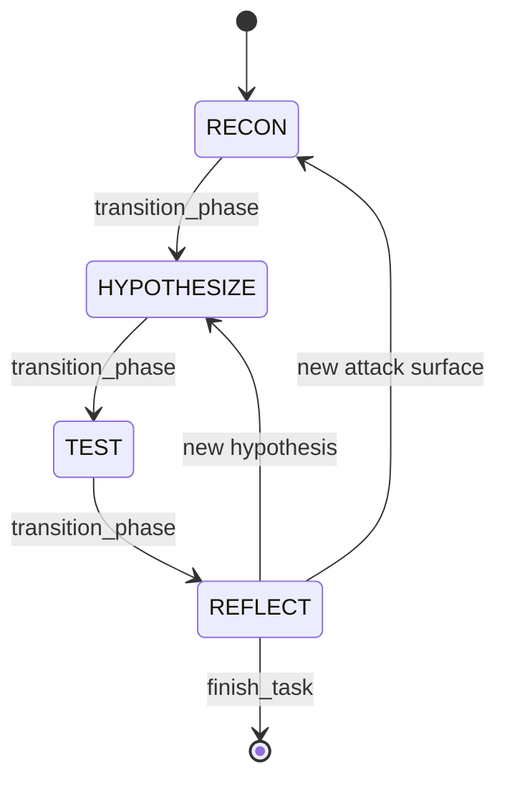
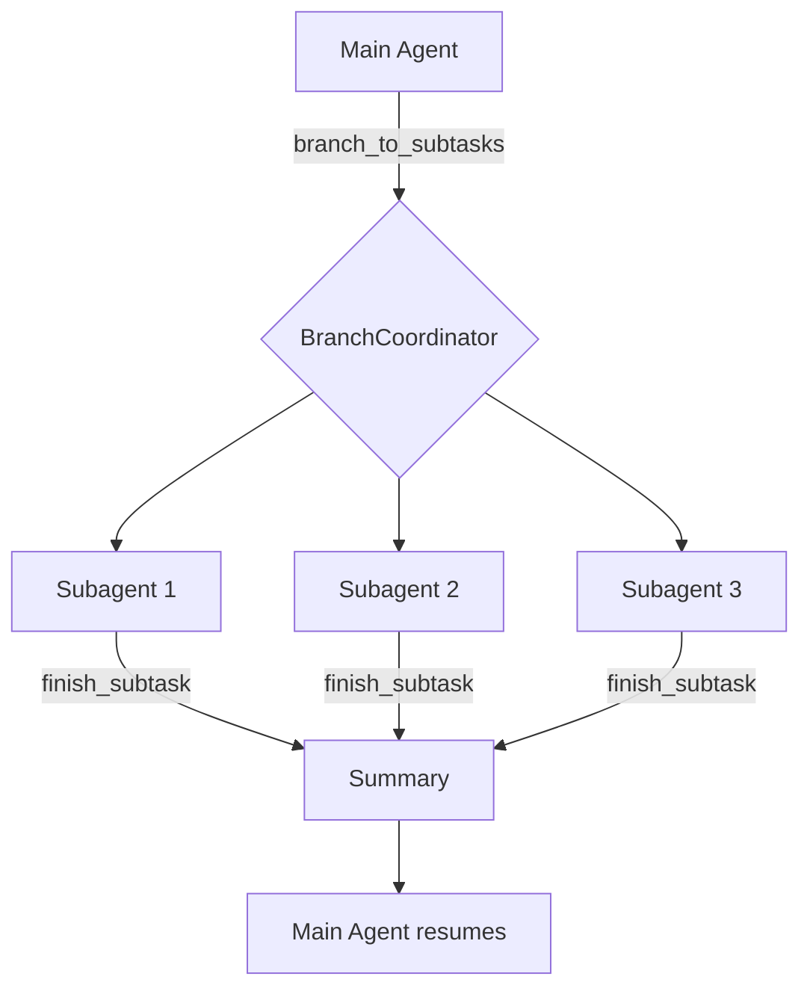
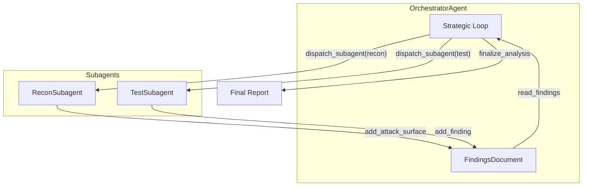

# Workflow

Tempo Sec follows a structured workflow that mimics how expert security researchers approach vulnerability discovery.

---

## Phase Overview



| Phase | Purpose | Outputs |
|-------|---------|---------|
| **RECON** | Gather information, map attack surfaces | Target manifest, notes |
| **HYPOTHESIZE** | Form hypotheses about vulnerabilities | Hypothesis list |
| **TEST** | Validate/disprove each hypothesis | Findings, PoCs |
| **REFLECT** | Analyze results, plan next steps | Revised plan |

---

## Phase Transitions

Transitions happen via the `transition_phase` tool call, not hardcoded logic:

```python
# Agent calls this tool to change phases
transition_phase(
    phase="test",
    justification="All hypotheses formed, ready to test",
    purpose="Begin testing the identified attack surfaces"
)
```

### Valid Transitions

| From | To | When |
|------|----|------|
| RECON | HYPOTHESIZE | Enough info gathered |
| RECON | RECON | Need more reconnaissance |
| HYPOTHESIZE | TEST | Hypotheses ready |
| HYPOTHESIZE | RECON | Need more information |
| TEST | REFLECT | Testing complete |
| TEST | TEST | More tests needed |
| REFLECT | RECON | New attack surface found |
| REFLECT | HYPOTHESIZE | New hypothesis formed |
| REFLECT | TEST | Need to verify finding |

---

## Branching & Parallel Testing

The agent can spawn parallel subagents to test multiple hypotheses simultaneously:



### How It Works

1. **Main agent** identifies multiple hypotheses to test
2. Calls `branch_to_subtasks` with list of objectives
3. **BranchCoordinator** spawns subagent clones
4. Each subagent tests independently, inheriting full context
5. Subagents call `finish_subtask` when done
6. Summaries merged back to main agent's context

### Key Benefits

- **Parallel exploration**: Test multiple paths simultaneously
- **Context preservation**: Each clone has full context
- **Token efficiency**: Only summaries return to main context

---

## Entry Points

### Orchestrator (Recommended)

The **OrchestratorAgent** provides fully autonomous security analysis by coordinating subagents:



```bash
# Run orchestrator (recommended)
tempo --agent orchestrator \
    --target https://example.com \
    --findings ./findings/example.yaml \
    --max-iterations 10
```

The orchestrator:
1. Starts with reconnaissance to discover attack surfaces
2. Dispatches test subagents for discovered surfaces
3. Iterates until adequate coverage is achieved
4. Generates a comprehensive final report

### Reconnaissance Script (`recon.py`)
Runs RECON phase only, generating a target manifest:

```bash
python -m tempo.scripts.recon \
    --objective "Map attack surface of example.com" \
    --output manifests/target.json
```

### Test Cycle Script (`test_cycle.py`)
Runs HYPOTHESIZE → TEST → REFLECT loop:

```bash
python -m tempo.scripts.test_cycle \
    --manifest manifests/target.json
```

---

## Configuration

Phase behavior is configured in `config.toml`:

```toml
[workflow]
enforce_phases = true          # Require explicit transitions
max_steps_per_phase = 20       # Prevent runaway phases
max_total_steps = 500          # Hard limit

[branching]
max_branches = 5               # Maximum parallel subagents
max_branch_depth = 3           # Maximum nesting
branch_step_limit = 100        # Steps per branch
```

---

## See Also

- [ARCHITECTURE.md](ARCHITECTURE.md) - Component structure
- [TOOLS.md](TOOLS.md) - Tool specifications including meta tools
